# CAREFLOW OPD
## FINAL PROJECT REPORT
### The Hospital Booking System for the Outpatient Department

**Team Aura**

| Student ID | Team member |
|---|---|
| 6931503085 | Apichaya Somrit |
| 6931503092 | Aung Phone Thant |
| 6931503093 | Min Hein Ko |
| 6931503098 | Yoon Yadanar MyintHtay |
| 6931503116 | Varichsara Kitiphatphiboon |

**Repository:** <https://github.com/Min-Hein-Ko/The-hospital-booking-system>  
**Live Demo:** <https://min-hein-ko.github.io/The-hospital-booking-system/>

> Academic front-end prototype using sample data. Not intended for real patient data or clinical operation.

---

# 01 | PROJECT CONTEXT

## Problem & Users

CareFlow OPD is a browser-based prototype designed to make outpatient appointment information and booking tasks easier to access. It focuses on the patient journey from finding a doctor to managing an appointment and checking a personal queue token.

### Problem & Users

**Patients need a convenient way to:**
- Find doctors and check availability.
- Book, cancel or reschedule appointments.
- Receive a token and check their own appointment status.
- Manage their profile and notifications.

**Admins need a clear way to:**
- Maintain doctor information and schedules.
- Monitor appointments, tokens and dashboard summaries.
- Manage patient account access.
- Review records without manually controlling the queue.

## Project Scope

**In scope:** patient registration/sign-in/profile, doctor discovery, appointment booking and management, personal token/status display, doctor and schedule administration, read-only Admin monitoring, patient account Ban/Restore, and in-app notifications.

**Out of scope:** billing, telemedicine, diagnosis/treatment advice, prescriptions, full electronic medical records, emergency services, insurance claims, online pharmacy and external hospital integration.

The defined system roles are Patient and Admin. Doctor is a profile/stakeholder record.

## Functional Requirements & Proposed MoSCoW

| ID | Requirement summary | Priority |
|---|---|---|
| FR-1 | Patients view doctor information and availability. | Must |
| FR-2 | Patients book appointments, provide optional visit reasons, and receive tokens. | Must |
| FR-3 | Patients view their own token numbers and appointment statuses. | Must |
| FR-4 | Patients cancel, reschedule, or arrange follow-up appointments. | Must |
| FR-5 | Admins manage doctor information and schedules. | Must |
| FR-6 | Admins monitor dashboards, appointments, and token records. | Must |
| FR-7 | Admins ban or restore patient accounts. | Must |
| FR-8 | Patients register, log in, and manage their profiles. | Must |
| FR-9 | Patients and Admins receive and manage notifications. | Must |

## Measurable Non-Functional Requirements

| ID / Type | Requirement | Verification |
|---|---|---|
| NFR-1 Performance | Doctor and appointment schedule pages shall load within 3 seconds under normal network conditions. | Measure page load time under normal network conditions. |
| NFR-2 Performance | The system shall create and display a patient's token number within 2 seconds after booking confirmation. | Measure the time between booking confirmation and token display. |
| NFR-3 Usability | A first-time user shall be able to find a doctor and complete an appointment booking in under 2 minutes without assistance. | Conduct a timed trial with a first-time user. |
| NFR-4 Reliability | The system shall save a confirmed appointment and its token number so that the records remain available after the user leaves or refreshes the appointment page. | Create an appointment, refresh the page, and verify the appointment and token records. |
| NFR-5 Security / Privacy | A user shall only be able to view and manage their own personal information and booking history. | Log in as one user and attempt to access another user's information; access must be prevented. |

---

# 02 | SYSTEM DESIGN

## Architecture & Design

The prototype is a front-end demonstration built with HTML5, CSS3 and JavaScript and published through GitHub Pages. It uses sample records in browser storage. The logical data model describes the target information structure.

### Logical Architecture

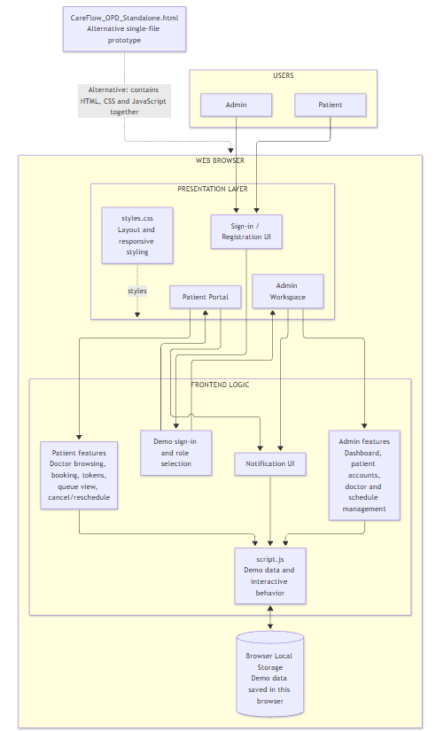

*Figure 1. CareFlow OPD logical architecture.*

### Use Case Diagram

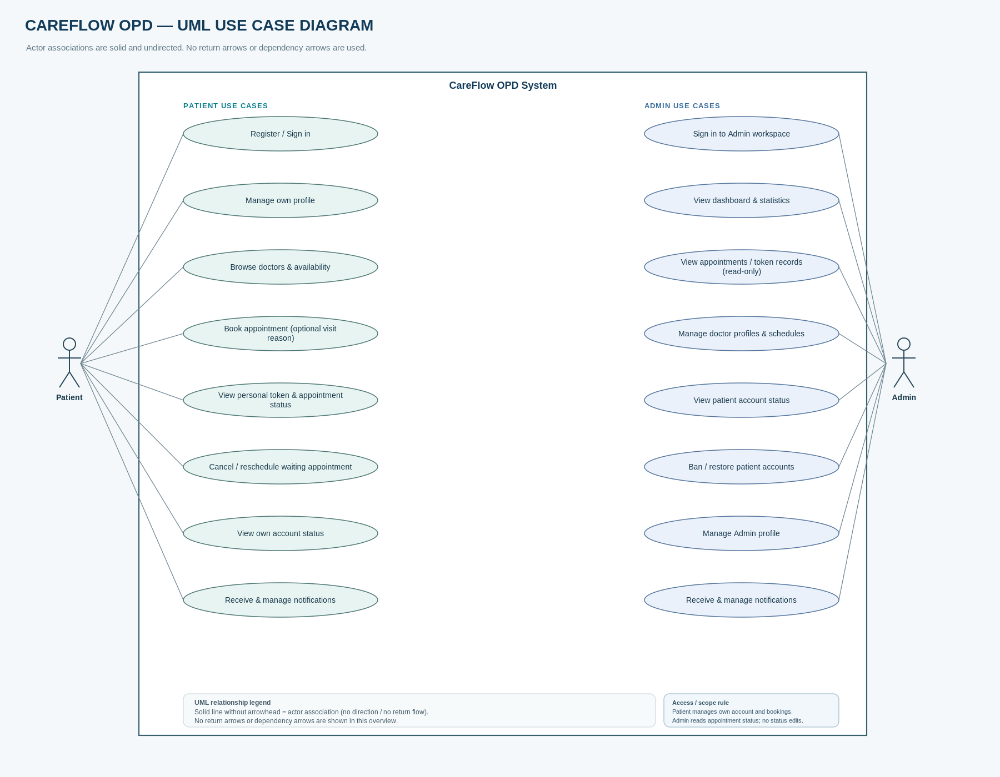

*Figure 2. CareFlow OPD use-case diagram.*

### Sequence Diagram

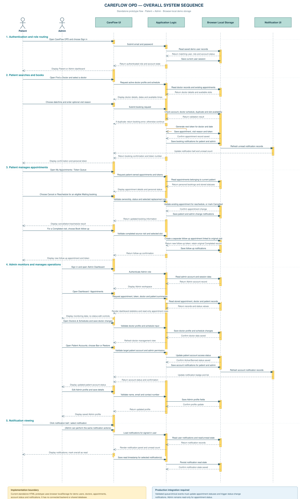

*Figure 3. Sequence diagram.*

---

# 03 | DATA MODEL AND PROTOTYPE

## Data Model & Prototype Build

### Logical Data Model

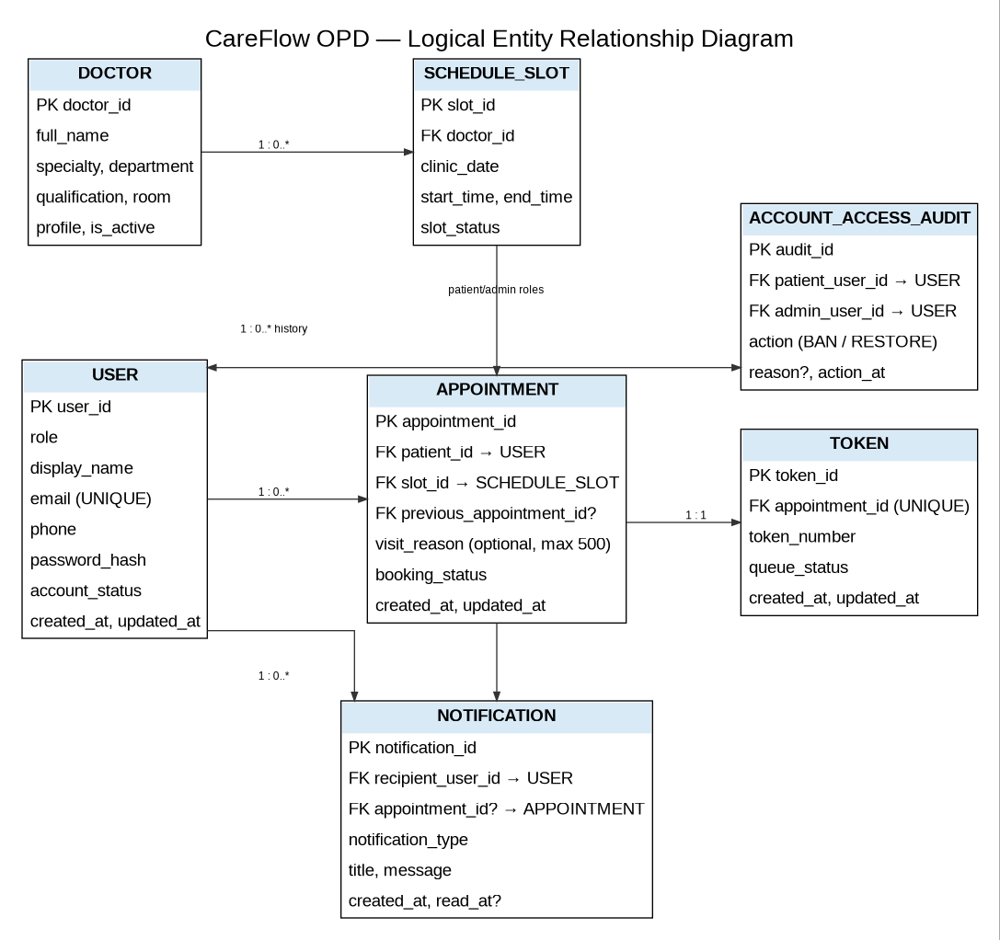

*Figure 4. CareFlow OPD logical entity-relationship diagram.*

### Prototype Build

| Item | Project information |
|---|---|
| Front-end technologies | HTML5, CSS3 and JavaScript |
| Repository / hosting | GitHub repository; published demo via GitHub Pages |
| Data handling | Sample records stored in browser for demonstration |
| User roles | Patient and Admin |
| Prototype boundary | Front-end demonstration only; not a production hospital system or completed backend |

The prototype demonstrates intended screens and interactions. It does not prove production-grade shared persistence, backend authentication/authorization, atomic concurrent booking, durable audit logging or external notification delivery.

## Prototype Screenshots — Insert Actual Browser Captures

### Prototype screenshots (Patient)

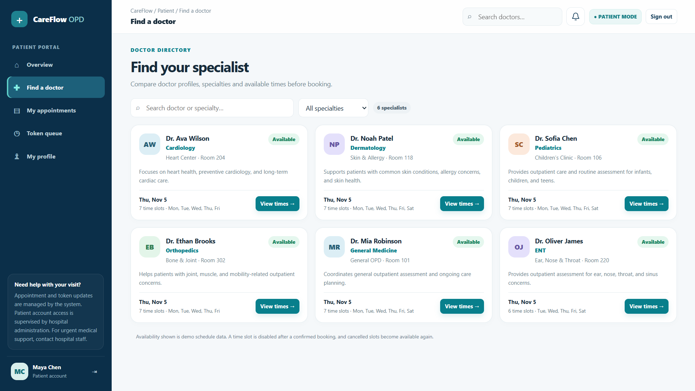

*Figure 5–7. Prototype screenshots (Patient).*

### Prototype screenshots (Admin)

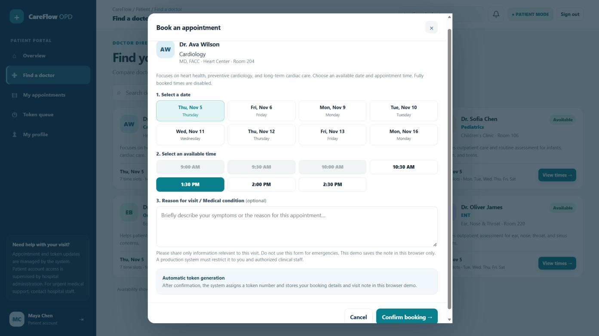

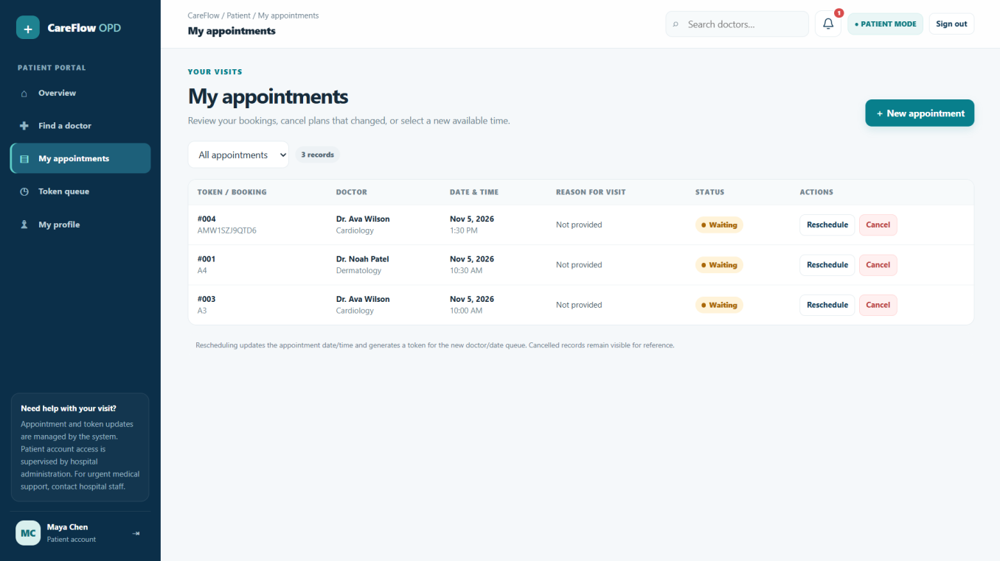

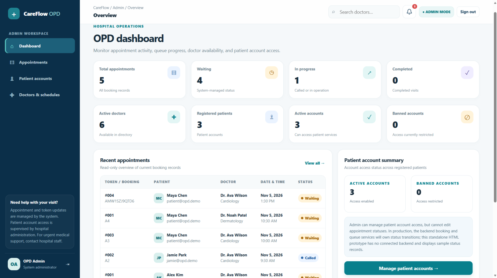

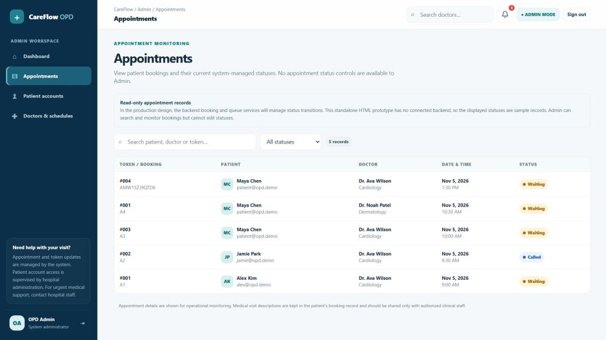

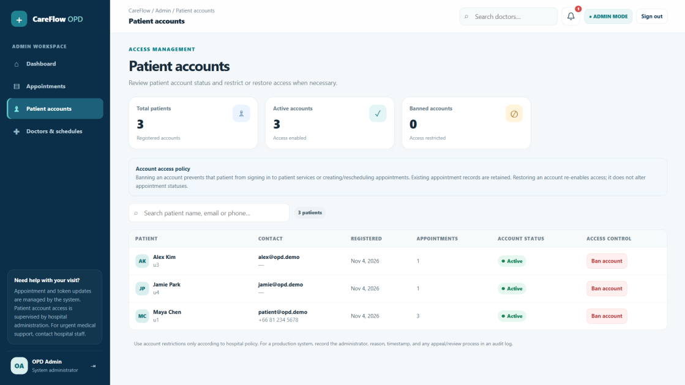

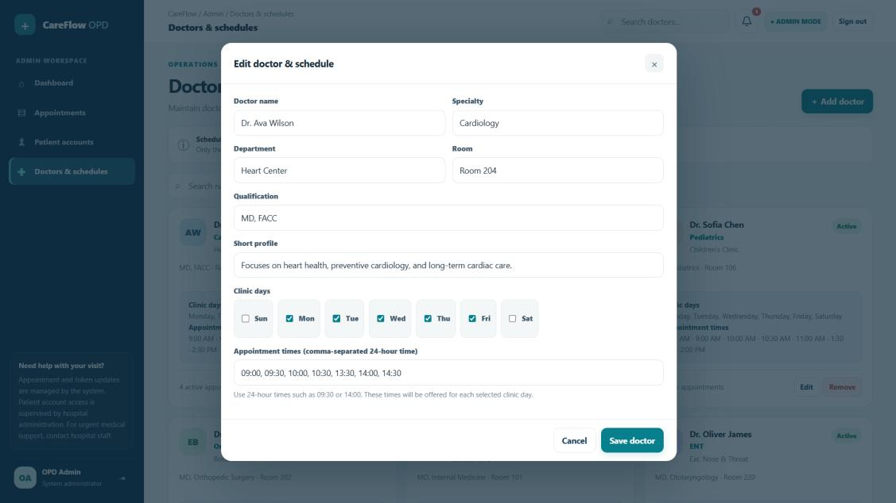

*Figure 8–10. Prototype screenshots (Admin).*

---

# 04 | VERIFICATION

## Testing Results — FR-1 to FR-5

Results below are organized from the team's supplied testing notes. “Pass (reported)” means the team reported the criterion as working in the prototype; it is not an independent re-test by the report author.

| FR | Test scenario | Expected result | Actual result |
|---|---|---|---|
| FR-1 | Open the doctor directory using the patient interface. | The directory presents doctors who are active and identifies each doctor's specialty. | **Pass.** Active doctors and their specialties can be viewed. |
| FR-1 | Open a doctor's booking options and inspect the available dates and times. | The patient can see the appointment dates and time slots offered for booking. | **Pass.** Available dates and times are displayed to the patient. |
| FR-1 | Attempt to choose a doctor or time slot that is already unavailable because it has been booked. | The unavailable doctor or time slot is disabled or otherwise prevented from being selected. | **Pass.** A time slot that has already been booked cannot be selected. |
| FR-2 | Complete the booking selection using an available doctor, date, and time. | The system accepts the selection when all chosen options are available. | **Pass.** A patient can select an available doctor, date, and time. |
| FR-2 | Submit an appointment booking and inspect the confirmation. | The system creates the appointment and assigns a token that begins in the Waiting state. It should also prevent duplicate bookings. | **Partially verified.** A token is generated after a successful booking. The recorded observation does not separately demonstrate the initial status or duplicate-booking prevention. |
| FR-3 | View the details shown after making an appointment. | The appointment view identifies the patient's token number, selected doctor, appointment date, and appointment time. | **Pass.** The token number and appointment date and time are shown after booking; the doctor is selected as part of the displayed appointment information. |
| FR-3 | Check the appointment after its status has been changed by the system. | The patient-facing view reflects the appointment status supplied by the system. | **Pass.** The prototype displays statuses such as Waiting and Cancelled in the observed situations. |
| FR-3 | Sign in as a patient and inspect the token information available in the account. | The patient can access their own appointment and token information, but not another patient's private token details. | **Pass.** The tested patient account did not provide access to other patients' token information. |
| FR-4 | Cancel an appointment that is still upcoming. | The appointment is cancelled and its status changes to Cancelled. | **Pass.** The appointment status changes to Cancelled after cancellation. |
| FR-4 | Reschedule an existing appointment by choosing another available date and time. | The system saves the new appointment time and issues a new token for the rescheduled booking. | **Pass.** A new available date and time can be selected, and a new token number is generated. |
| FR-4 | Create a follow-up appointment after an earlier appointment has been completed. | The new booking is stored as a separate appointment, while the completed appointment remains in the patient's history. | **Not tested.** The team did not perform this scenario because the observed appointment flow ended with a Completed status and no follow-up booking was required. |
| FR-5 | Use the administrator interface to edit a doctor's details and schedule. | An administrator can update the doctor's information and availability. | **Pass.** Doctor information and schedules can be edited from the administrator interface. |
| FR-5 | After an administrator saves a doctor or schedule change, view the same information as a patient. | The patient interface displays the updated doctor information and availability. | **Pass.** The changes saved by the administrator are visible from the patient interface. |
| FR-5 | Attempt to remove a doctor who has an existing active appointment. | The system blocks deletion when removing the doctor would affect an existing appointment record. | **Pass.** A doctor with an existing active appointment cannot be removed. |

## Testing Results — FR-6 to FR-9

| FR | Test scenario | Expected result | Actual result |
|---|---|---|---|
| FR-6 | Open the administrator dashboard and review its summary information. | The dashboard provides an overview of appointment activity, active doctors, and patient accounts. | **Pass.** The administrator dashboard can be used to monitor the system overview. |
| FR-6 | Open the appointment and token information from the administrator interface. | The administrator can inspect appointment and token information, including locating relevant records where the interface provides search or filtering. | **Partially verified.** The team confirmed that the administrator can check the records. The recorded observation does not separately confirm every search and filter operation. |
| FR-6 | Inspect appointment status and token information from the administrator dashboard. | The administrator can view this information but cannot manually change appointment statuses or control the token queue through the dashboard. | **Pass.** Appointment and token information are view-only in the administrator dashboard. |
| FR-7 | Open a patient's account details from the administrator interface. | The administrator can view patient information and identify whether the account is Active or Banned. | **Pass.** The administrator can check an individual patient's account status. |
| FR-7 | Ban a patient account and then use the restore option. | The administrator can restrict the account and later restore its access. | **Partially verified.** The Ban and Restore Access actions were successfully observed. The recording does not separately confirm an audit log of these actions. |
| FR-7 | Try to use appointment services while signed in to a banned patient account. | The system blocks the account from booking or rescheduling and displays an access-restriction message. | **Pass.** The banned account displayed an account-access restriction message. |
| FR-8 | Check the entry points for a new and an existing patient. | A new patient can start registration, while a registered patient can access the sign-in option. | **Pass.** The interface provides Create an Account and Sign In options. |
| FR-8 | Open the patient profile and edit personal details. | The patient can update their own profile information, including name, email address, and phone number. | **Pass.** The tested profile allowed these personal details to be edited. |
| FR-8 | Attempt to access booking or rescheduling while the patient account is banned. | Restricted accounts cannot use appointment booking or rescheduling until access is restored. | **Pass.** The banned account was prevented from using the system and showed an access-restriction message. |
| FR-9 | Open the notification area and inspect the unread notification indicator. | The interface displays notifications and indicates how many are unread. | **Pass.** Notifications can be opened, and an unread count is displayed. |
| FR-9 | Open a notification and use the control to mark notifications as read. | The user can read notifications and mark an individual notification or all notifications as read. | **Pass.** The team confirmed that the Mark All as Read control can be used to clear the unread state. |
| FR-9 | Reschedule an appointment and inspect the notification received by the patient. | The system sends a relevant notification after the change and does not expose the patient's visit-reason description in the notification. | **Partially verified.** A notification related to a successful reschedule was observed. Notifications for every listed event type and the exclusion of visit-reason information were not separately documented as tested. |

## Test outcome summary

| Outcome | Number of tests | Meaning |
|---|---:|---|
| Pass | 21 | The recorded observation supports the expected behavior for the tested scenario. |
| Partially verified | 4 | Some behavior was observed, but one or more parts of the combined expected result were not separately confirmed in the test record. |
| Not tested | 1 | The team did not execute the scenario. |
| **Total** | **26** | All test scenarios listed in this document. |

---

# 05 | RESPONSIBLE AI USE

## AI Usage Log

AI was used as a support tool for brainstorming, organization, explanation, drafting and troubleshooting. The team retained responsibility for project decisions, reviewing outputs, checking consistency and deciding what to include.

### AI Usage Record: M1–M3

| Deliverable | How ChatGPT supported the work | Team contribution and review |
|---|---|---|
| M1 — Project idea and initial definition | Brainstormed and compared project directions; suggested ways to clarify the OPD problem, purpose, scope and document structure. | The team selected the hospital OPD booking topic, supplied context, decided scope, revised wording and checked relevance and consistency. |
| M2 — Requirements and analysis | Helped organize requirement sections, improve wording and explain FR/NFR, user stories, acceptance criteria, roles, booking and token-queue features. | The team determined requirements, adjusted them to the agreed workflow, and reviewed clarity, feasibility, duplication and scope consistency. |
| M3 — Design and project refinement | Provided writing/review support, design explanations, section-organization suggestions and feedback on consistency between requirements and proposed design. | The team supplied project decisions, incorporated relevant suggestions and reviewed M3 against system features and earlier documentation. ChatGPT was not the authority for technical or operational decisions. |

### AI Usage Record: Diagrams, Prototype and Presentation

| Work product | How ChatGPT supported the work | Team review before repository push |
|---|---|---|
| UML and system diagrams | Explained UML conventions; suggested improvements to actors, use-case relationships, appointment/token flows, sequence order, include and extend relationships. | The team checked actors, boundaries, labels, flow direction and UML relationships against requirements; confusing elements were revised. |
| Front-end prototype | Supported HTML, CSS and JavaScript through code explanations, layout/wording suggestions and troubleshooting guidance. | The team opened the prototype locally and checked rendering, navigation, interactions, labels and patient/Admin requirements. Changed files were reviewed before commits and pushes. |
| Demo / presentation slides | Helped organize presentation flow, summarize project information and improve slide wording and clarity. | The team compared slides with M1–M3, diagrams and prototype, and checked that claims did not exceed documented scope. |
| GitHub repository preparation | Provided guidance on file organization, folder structure and general repository practices when requested. | The team reviewed files, names and folder placement, opened key documents/diagrams/prototype files, corrected visible issues and pushed after team review. |

### AI Use and Accountability

AI-generated suggestions were reviewed rather than accepted automatically. The team remained responsible for technical decisions, prototype behaviour, source accuracy, repository content and final submission. AI assistance does not establish that a feature was implemented or tested; implementation and test claims are limited to team-supplied observations and available project evidence.

---

# 06 | OWNERSHIP AND TRACEABILITY

## Team Contributions & Golden Thread

### Individual Contributions

| Team member | Github | Contribution |
|---|---|---|
| Min Hein Ko | Min-Hein-Ko | M1, M2, Prototype, Diagrams, README |
| Yoon Yadanar Myint Htay | yoonymh1 | M1, M2, Specification, UI |
| Varichsara Kitiphatphiboon | jazzvarichsara-stack | M1, M2, UI, Process and Team Coordination |
| Aung Phone Thant | 6931503092-lgtm | M1, M2, Functional Requirements (FR), Non-Functional Requirements (NFR), Use Cases |
| Apichaya Somrit | inriSSh | M1, M2, Data Model, Screen List, Traceability Summary (Golden Thread) in the SRS |

## Golden Thread Traceability

| Problem / Need | Requirement | Design | Feature | Test |
|---|---|---|---|---|
| Patients need to find doctors and check availability. | FR-1 | SC-04 Find a Doctor | Doctor search, specialty filter, active doctor list, and available appointment slots. | **Pass:** Active doctors, specialties, available dates and times were displayed. Unavailable doctors and booked time slots could not be selected. |
| Patients need to book appointments and receive a token. | FR-2, FR-3 | SC-04 Find a Doctor → SC-06 Token Queue | Book an appointment, provide an optional visit reason, generate a token, and display booking confirmation. | **Partial Pass:** Patients could select available booking options and received a token after successful booking. Token uniqueness and duplicate-booking prevention were not fully verified. |
| Patients need to know their queue progress. | FR-3 | SC-06 Token Queue | Display the patient's own token number and current queue status. | **Pass:** The patient's own token and appointment details were displayed. Other patients' tokens could not be viewed. Waiting and Cancelled statuses were observed. |
| Patients may need to change appointments or book a follow-up. | FR-2, FR-4 | SC-05 | SC-05 My Appointments | **Partial Pass:** Cancellation updated the status to Cancelled. Rescheduling to another available slot generated a new token. Follow-up booking was Not tested because no follow-up was needed during testing. |
| Admins need to maintain accurate doctor information and schedules. | FR-5 | SC-11 Doctors & Schedules | Add, edit, and remove (deactivate) doctor records; manage clinic days and appointment times. | **Pass:** Admins could edit doctor information and schedules, and the updated information appeared in the patient view. Permanent removal of doctors with active appointments was prevented. |
| Admins need to monitor appointments and patient accounts without changing appointment or queue statuses. | FR-6, FR-7 | SC-08 Admin Dashboard → SC-09 Admin Appointments → SC-10 Patient Accounts | View dashboard statistics and appointment records; Ban or Restore patient accounts. | **Pass:** Admins could monitor dashboard information and view appointment/token records without editing them. Admins could view account status, Ban/Restore accounts, and banned patients were blocked from access. |
| Patients need to create accounts and manage their personal information. | FR-8 | SC-01 Sign In / Register → SC-07 My Profile | Register, log in, and update profile information. | **Pass:** Sign-in and account-creation options were available. Patients could edit their name, email and phone number. Banned accounts were restricted. |
| Patients and Admins need to receive and manage important system updates. | FR-9 | SC-03 Patient Overview / SC-08 Admin Dashboard → Notification Panel | Display notifications, unread count, notification list, and Mark as Read actions. | **Partial Pass:** Users could view notifications and unread counts, and mark all as read. A notification after rescheduling was observed. Other notification types and the exclusion of visit-reason information still need verification. |

---

**TEAM AURA**
