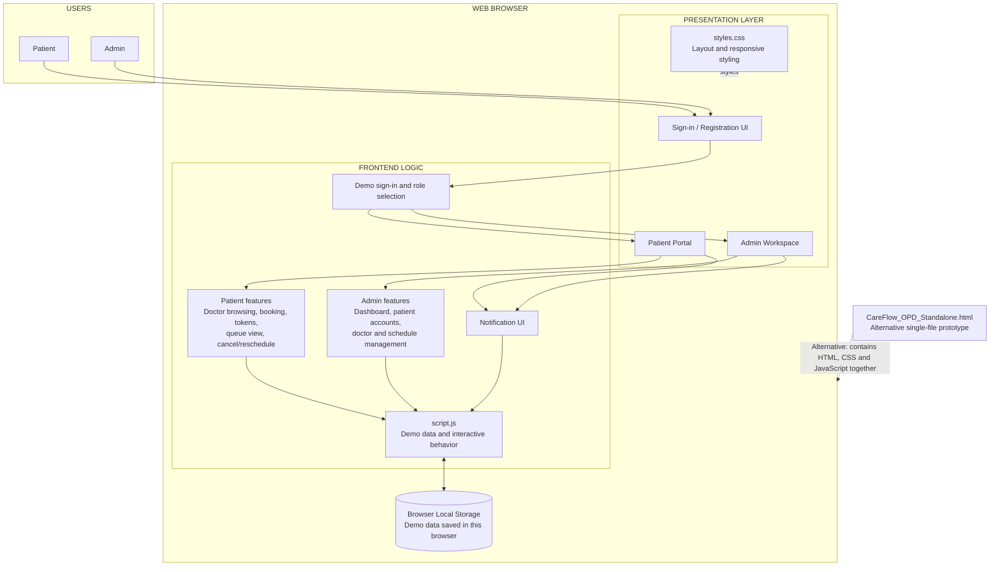

# CareFlow OPD — Current Prototype Architecture

This diagram describes the **current repository implementation** documented in the project README. It is a frontend-only web prototype built with HTML, CSS and JavaScript.

## Main components

| Component | Responsibility |
|---|---|
| `index.html` | Main web page and application structure |
| `styles.css` | Layout, visual styling and responsive design |
| `script.js` | Demo data and interactive frontend behavior |
| Browser Local Storage | Saves demo changes in the current browser |
| `CareFlow_OPD_Standalone.html` | Alternative single-file version containing its own HTML, CSS and JavaScript |

## User roles

- **Patient:** Register/sign in, browse doctors and schedules, book appointments, view tokens and appointment status, and cancel or reschedule eligible appointments.
- **Admin:** View dashboard information, manage patient account access, and add, edit or deactivate doctor profiles and schedules. The current README states that appointment and token statuses are read-only for Admin.

## Current implementation limitations

- No real backend server or production database is connected.
- Authentication is demonstrated in the frontend; it is not a production authentication service.
- Local Storage is browser-specific and does not synchronize data between users, browsers or computers.
- Appointment and token status behavior is simulated; the prototype does not provide real-time queue operations or notifications.
- Do not enter real patient, medical or personal information.

## Intended production direction

A production version would need a server-side application/API, secure authentication and authorization, a shared persistent database, and server-controlled appointment and token workflows. Those components are **future architecture**, not part of the current repository prototype.
